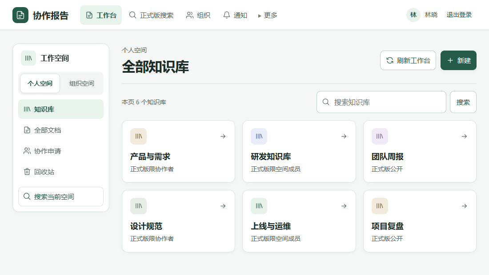

# 协作报告

协作报告是一个面向团队的章节级文档协作平台。以迭代报告为例，成员从知识库打开报告，在章节的共同支线上实时编辑，提交审核后将改动合入主线。正式发布的版本支持全文搜索，文档可导出为 DOCX、PDF 或 Markdown 资源包。

[界面示例](#界面示例) · [技术栈](#技术栈) · [运行与部署](#运行与部署)

## 技术栈

| 模块 | 主要技术 |
| --- | --- |
| 账号、文档、搜索服务 | Go、go-zero、MySQL（账号服务另用 Redis） |
| 实时协作服务 | Node.js、Yjs CRDT、WebSocket |
| 浏览器端 | Vue 3、TypeScript、ProseMirror、IndexedDB |
| 全文索引 | Canal、Kafka、Elasticsearch |

四个服务通过 gRPC 和 Protobuf 交互。完整技术栈、服务职责和核心流程见[技术说明](docs/TECHNICAL.md)。

## 界面示例

以下截图来自实际界面，使用样例账号和文档。

### 知识库工作台

在个人或组织空间中管理知识库，查看正式版的可见范围，按名称查找知识库并打开文档。



### 章节协作编辑

从报告中选定一个章节进入共同支线。编辑器显示同步与保存状态，支持表格、公式、图片及 Markdown 导入。


### 送审与合并

审核者可以对照本轮送审稿和固定基线查看改动。审核通过后，系统以共同基线、送审稿和当前主线执行三方合并。


## 运行与部署

### Windows 本机

本机MySQL、Redis、Kafka、Elasticsearch、Canal全部由Docker Compose启动，无需安装它们的Windows版本。三个Go服务和一个Node协作服务在本机运行，便于调试，同源HTTPS入口提供前端与WSS。

准备 Go 1.25.10、Node.js 24.19.0（含 npm）、Docker Desktop（Linux 容器）、OpenSSL、Python（含 `jsonschema`）、Pandoc 3.8 和 Edge。在克隆后的项目根目录运行以下命令。

```powershell
$env:GOWORK = 'off'
./scripts/npm.ps1 ci
./scripts/npm.ps1 run typecheck --workspace web
./scripts/npm.ps1 run build --workspace web
node --no-maglev scripts/dev-environment.mjs up
node --no-maglev scripts/login-environment.mjs
node --no-maglev scripts/search-environment.mjs
node --no-maglev scripts/start.mjs
```

四个服务就绪后，打开启动日志给出的 HTTPS 地址。首次准备生成当前实例的 `.runtime/` 配置和凭据。重启已有实例时使用原配置和数据卷，按[Windows 运行与排错](docs/operations/WINDOWS.md)操作。

开发SMTP将验证码保存在当前项目私有目录，不发到真实邮箱。注册可使用example.test邮箱；在另一个终端读取：

```powershell
./scripts/show-mail.ps1 -Email 'demo-a@example.test' -Limit 1
```

停止只操作核验归属的本项目环境，保留持久卷：

```powershell
node --no-maglev scripts/start.mjs stop
node --no-maglev scripts/dev-environment.mjs stop
```

### Linux 服务器

[Linux 部署](docs/operations/LINUX.md)提供 Ubuntu 24.04 的 Docker Compose 安装与升级步骤。SMTP、对象存储和运行配置见[配置说明](configs/README.md)。实例迁移和数据恢复见[备份与恢复](docs/operations/BACKUP-RESTORE.md)。

## 检查与测试

在已配置 Go、Node.js 和 Python 的项目根运行 `./scripts/verify-quality.ps1`，检查格式、离线规则、契约、前端类型和生产构建。结果保存在 `artifacts/current-quality/verification.json`。真实接口、数据库、WebSocket 与故障恢复测试应使用独立实例，参见[Windows 测试说明](docs/operations/WINDOWS.md#验证)。
