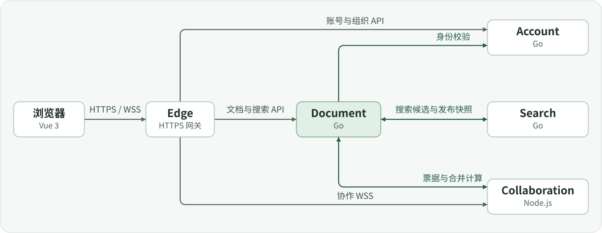
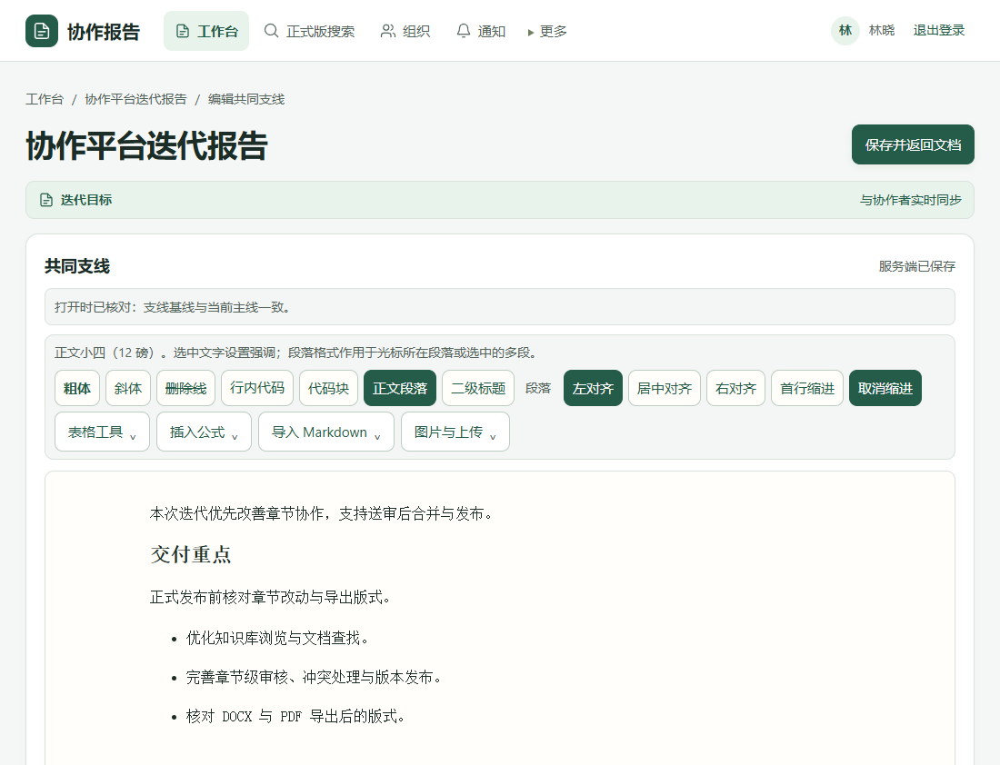
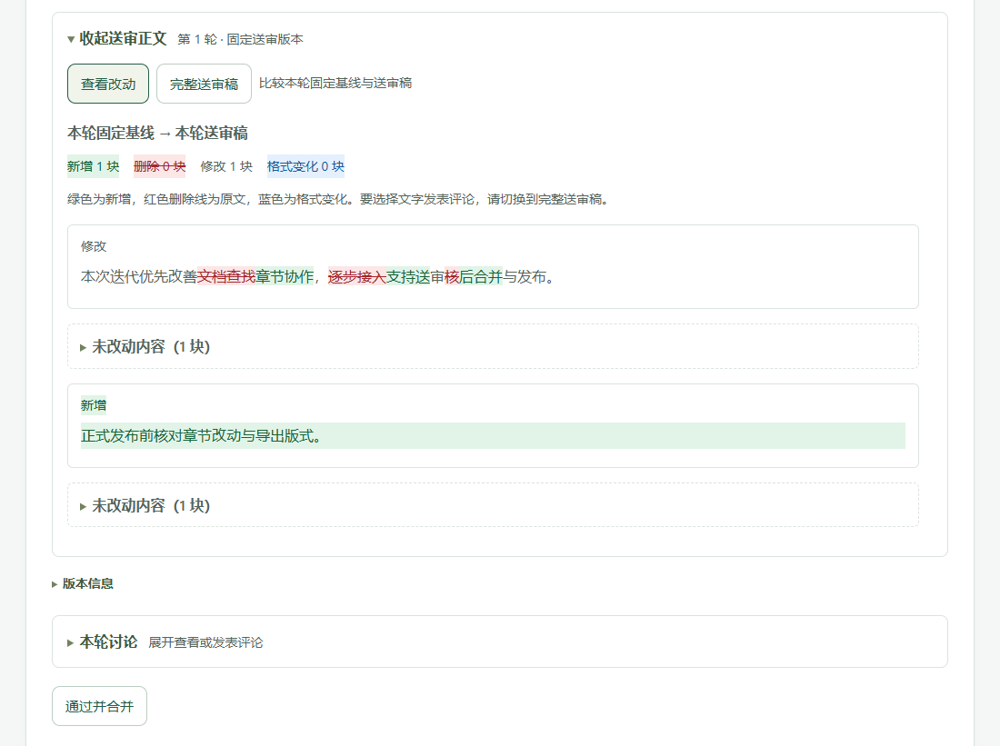

# 协作报告

协作报告是一个**采用微服务架构的章节级文档协作平台**。后端由三个 Go 服务和一个 Node.js 服务组成。

团队从知识库打开报告，按章节在共同支线上实时协作，审核通过后合并到主线。发布的正式版本支持全文检索，文档可导出为 DOCX、PDF 或 Markdown 资源包。

[系统架构](#系统架构) · [技术栈](#技术栈) · [界面示例](#界面示例) · [运行与部署](#运行与部署)

## 核心设计

- **实时协作与可靠保存**。使用 Yjs CRDT 合并多人编辑增量。浏览器通过 IndexedDB 保留待确认的修改，服务端持久化后再确认保存，断线重连时续传。
- **章节版本与审核**。按章节维护主线和共同支线，送审时固定正文、样式和资源。合并以共同基线、送审稿和当前主线为输入，兼容修改可合入主线，冲突可定位并人工修复。
- **正式版发布与检索**。Document 在同一 MySQL 事务中更新发布状态并写入 Outbox 事件。Search 消费 Canal 转发到 Kafka 的变更并更新 Elasticsearch，Document 复核搜索候选的发布状态和访问权限。

## 系统架构

浏览器通过项目的 Edge 网关加载前端、调用 HTTPS API 和建立 WebSocket 连接。下图展示主要调用链，业务服务之间使用 gRPC、Protobuf 和 mTLS。



| 服务 | 语言 | 职责 |
| --- | --- | --- |
| Account | Go | 账号、会话、组织和成员身份 |
| Document | Go | 知识库、文档与章节版本、权限、审核、发布和导出 |
| Collaboration | Node.js | Yjs 房间、编辑增量持久化、断线恢复和富文本合并计算 |
| Search | Go | 正式版全文索引、检索候选和索引重建 |

四个服务拥有独立入口、配置和私有数据库权限。当前 Linux 发行将四个服务与 Edge 放在同一个应用容器中，各自运行在独立进程内，由监督器统一启停。 [Linux 部署拓扑](docs/operations/LINUX.md#拓扑与持久事实)

## 技术栈

| 模块 | 主要技术 |
| --- | --- |
| 服务端 | Go、go-zero、Node.js、gRPC、Protobuf、mTLS |
| 实时编辑 | Yjs CRDT、WebSocket、ProseMirror、y-prosemirror |
| 浏览器端 | Vue 3、TypeScript、Vite、IndexedDB |
| 数据与检索 | MySQL、Redis、Canal、Kafka、Elasticsearch |
| 资源、导出与部署 | 本地文件或阿里云 OSS、Pandoc、Playwright/Chromium、Docker Compose |

服务契约、数据边界和关键流程见[技术说明](docs/TECHNICAL.md)。

## 界面示例

以下截图来自实际界面，使用样例账号和文档。

### 知识库工作台

在个人或组织空间中管理知识库，查看正式版的可见范围，按名称查找知识库并打开文档。


### 章节协作编辑

从报告中选定一个章节进入共同支线。编辑器显示同步与保存状态，支持表格、公式、图片及 Markdown 导入。



### 送审与合并

审核者可以对照本轮送审稿和固定基线查看改动，并发起三方合并。出现冲突时可以打开修复工作台。



## 运行与部署

### Windows 本机

Docker Compose 启动 MySQL、Redis、Kafka、Elasticsearch 和 Canal。四个应用服务与 Edge 在 Windows 本机运行。

准备 Git、Go 1.25.10、Node.js 24.19.0（含 npm）、Docker Desktop（Linux 容器）、OpenSSL、Python（含 `jsonschema`）、Pandoc 3.8 和 Edge。启动 Docker Desktop 后执行以下命令。

```powershell
git clone https://github.com/Lio6x1/collaboration-report.git
cd collaboration-report
$env:GOWORK = 'off'
./scripts/npm.ps1 ci
./scripts/npm.ps1 run typecheck --workspace web
./scripts/npm.ps1 run build --workspace web
node --no-maglev scripts/dev-environment.mjs up
node --no-maglev scripts/login-environment.mjs
node --no-maglev scripts/search-environment.mjs
node --no-maglev scripts/start.mjs
```

启动日志显示 `READY` 后，打开日志给出的 HTTPS 地址。重启时沿用原实例的 `.runtime/` 配置和数据卷。 [Windows 运行与排错](docs/operations/WINDOWS.md)

本机可以用 `demo-a@example.test` 注册。开发 SMTP 的验证码保存在本机，在另一个 PowerShell 窗口从仓库根目录读取。

```powershell
./scripts/show-mail.ps1 -Email 'demo-a@example.test' -Limit 1
```

登录后可沿着 **新建知识库与文档 → 创建章节 → 编辑共同支线 → 提交审核 → 合并并发布** 体验主流程。

运行以下命令停止本机实例并保留数据卷。

```powershell
node --no-maglev scripts/start.mjs stop
node --no-maglev scripts/dev-environment.mjs stop
```

### Linux 服务器

[Linux 部署](docs/operations/LINUX.md)提供 Ubuntu 24.04 的 Docker Compose 安装与升级步骤。SMTP、对象存储和运行配置见[配置说明](configs/README.md)。实例迁移和数据恢复见[备份与恢复](docs/operations/BACKUP-RESTORE.md)。

## 检查与测试

在已配置 Go、Node.js 和 Python 的项目根运行 `./scripts/verify-quality.ps1`，检查格式、离线规则、契约、前端类型和生产构建。结果保存在 `artifacts/current-quality/verification.json`。真实接口、数据库、WebSocket 与故障恢复测试应使用独立实例，参见[Windows 测试说明](docs/operations/WINDOWS.md#验证)。
